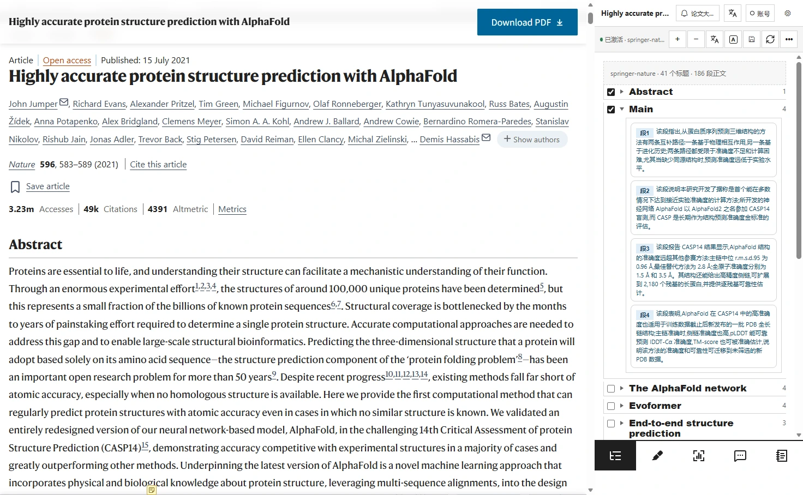
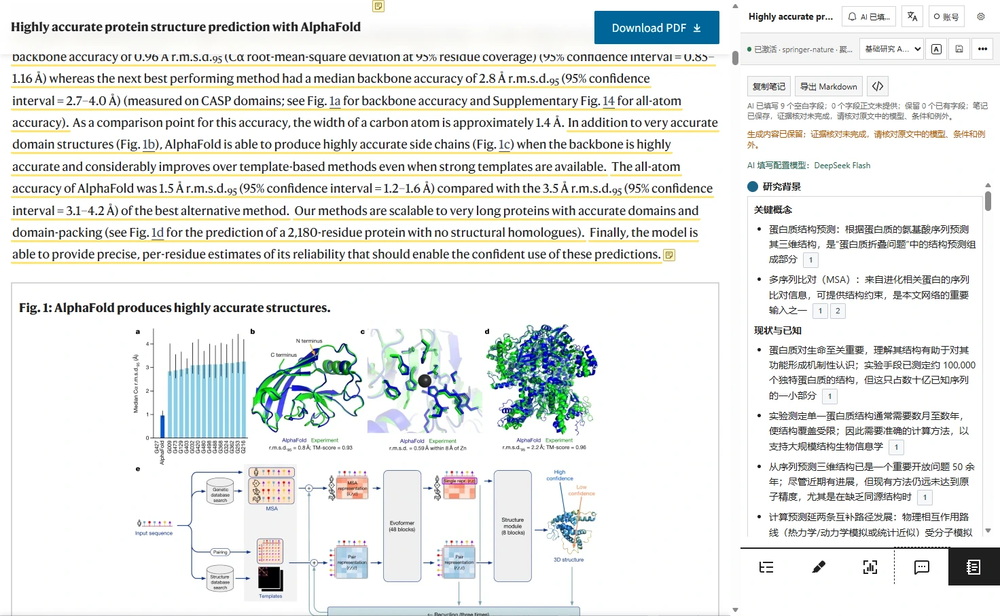
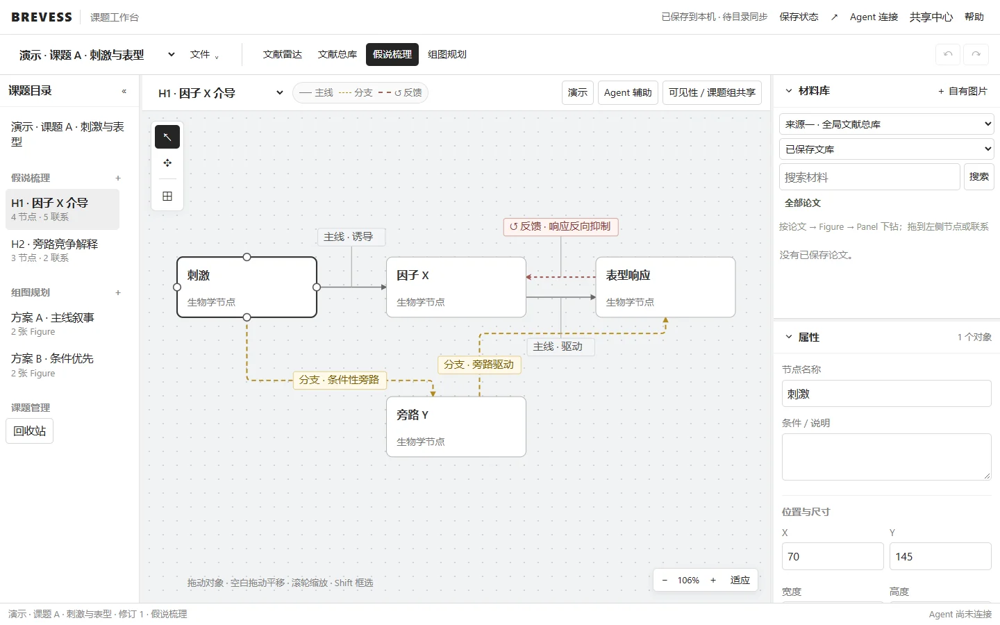

<p align="center"></p>
<h1 align="center">BREVESS</h1>
<p align="center"><strong>Brevity · Evidence · Essence</strong></p>
<p align="center">快速凝练真实、有用的信息，构建知识结构，推动科学研究。</p>
<p align="center">Chrome / Edge · 免费开源 · 中文 / English · 自备模型 API</p>
<p align="center"><a href="https://coolcoldplay.github.io/Brevess/"><strong>官网 · 实测演示</strong></a> · <a href="https://github.com/coolcoldplay/Brevess/releases/tag/v1.0.2-r27-20261117"><strong>1.0.2 r27 预览版</strong></a> · <a href="docs/使用教程.md">使用教程</a></p>

**大部分功能支持手动完成，也可由 AI 辅助。** 从大纲、标注和笔记，到证据整理、假说与组图规划，按自己的节奏积累知识。

## 五个阅读模块

**大纲 → 高亮 → 解图 → 问答 → 笔记**

以下均使用 **AlphaFold 2 的 Nature 原论文**。解图与问答来自 2026-11-17 的 Chrome / BREVESS 1.0.2 r27 实测和 DeepSeek 实际输出；大纲、高亮和笔记保留早期版本实录。

### 1. 大纲

先看论文结构，再进入段落；需要时由 AI 辅助概述，点击标记回到原文。



[观看大纲演示](https://coolcoldplay.github.io/Brevess/assets/site/real-navigation.mp4)

### 2. 高亮

手动标记重要句子，或让 AI 按背景、问题、方法与结果梳理正文。


[观看高亮演示](https://coolcoldplay.github.io/Brevess/assets/site/real-highlights.mp4)

### 3. 解图

原图与解读并排，逐 Figure / Panel 查看目的、设计、观察和结论，继续追问或手动修订。


[观看解图关键画面](https://coolcoldplay.github.io/Brevess/assets/site/r27-figures.webm)

### 4. 问答

在侧栏与大模型讨论论文：比较 Evoformer、结构模块与 recycling，追问方法与结论，再循着回答中的引用核对原文。


[观看问答关键画面](https://coolcoldplay.github.io/Brevess/assets/site/r27-chat.webm) · [查看宽表格展开示例](docs/assets/site/r27-chat-table.webp)

### 5. 笔记

把研究背景、科学问题与主要发现整理为笔记；可手动编辑，也可让 AI 辅助填写。



[观看笔记演示](https://coolcoldplay.github.io/Brevess/assets/site/real-notes.mp4)

论文及图表：Jumper et al., [Nature (2021)](https://www.nature.com/articles/s41586-021-03819-2)，[CC BY 4.0](https://creativecommons.org/licenses/by/4.0/)。截图未改写 AI 回答；新视频为关键画面剪辑，不表示生成速度。[素材记录与限制](docs/media/alphafold-r27.md)。

## 课题工作台

**文献雷达 → 文献总库 → 假说梳理 → 组图规划**

| [1. 文献雷达](https://coolcoldplay.github.io/Brevess/assets/site/wb-radar.mp4) | [2. 文献总库](https://coolcoldplay.github.io/Brevess/assets/site/wb-library.mp4) |
| :---: | :---: |
|  |  |
| 保存检索式，追踪文献与阅读状态。 | 汇集文献，查找来源与阅读记录。 |

| [3. 假说梳理](https://coolcoldplay.github.io/Brevess/assets/site/wb-hypothesis.mp4) | [4. 组图规划](https://coolcoldplay.github.io/Brevess/assets/site/wb-figures.mp4) |
| :---: | :---: |
|  |  |
| 用节点与连线组织机制，关联支撑证据。 | 按 Figure / Panel 规划实验与论证顺序。 |

从手动整理开始，也可借助 AI 辅助完善研究思路。支持多套方案、本机保存、撤销重做与导入导出。

工作台画面为**早期版本实录**，使用合成文献和内置演示课题；点击模块标题可观看视频。

## 安装预览版

1. [下载浏览器 ZIP](https://github.com/coolcoldplay/Brevess/releases/download/v1.0.2-r27-20261117/Brevess-v1.0.2-r27-Chrome.zip)，解压到独立文件夹。
2. 打开 `chrome://extensions/`（Edge 使用 `edge://extensions/`）→ 开发者模式 → 加载已解压的扩展程序，选择包含 `manifest.json` 的文件夹。
3. 固定 BREVESS 图标，在论文全文页打开侧栏；在设置中心配置自己的模型。

大纲导航、离线规则、手动高亮、笔记编辑和工作台无需 API Key。部分增强功能需要可选本机伴侣，当前浏览器 ZIP 不包含本机二进制。

**这是预览版。**完整自动回归仍有失败和超时；补充图目录提取也可能不完整。请参阅[发布记录](https://github.com/coolcoldplay/Brevess/releases/tag/v1.0.2-r27-20261117)，不要把演示成功等同于全功能验收。尚未宣称通过 Chrome Web Store 审核。

## 源码与构建

插件源码集中在 [`extension/`](extension/)，构建脚本在 `scripts/`，回归测试在 `tests/`，官网和文档在 `docs/`。

从 GitHub 克隆或下载源码后，Chrome「加载已解压的扩展程序」选择 **`extension/` 文件夹**。Release ZIP 的安装方式不变，仍选择解压后直接包含 `manifest.json` 的文件夹。

Node.js 20+，以下命令均在仓库根目录运行：

```sh
npm ci
npm run test:chrome-store
npm run build:public -- --name Brevess-Public-v1.0.2
```

公开预览包保留现有扩展标识，产物位于 `dist/<名称>/`。另需准备商店上传包时：

```sh
npm run build:chrome-store -- --name Brevess-Chrome-v1.0.2
npm run verify:chrome-store -- dist/Brevess-Chrome-v1.0.2
```

`npm test` 运行完整现有回归；已知范围见[发布检查说明](docs/chrome-store/RELEASE_READINESS.md)。构建与许可见 [OPEN_SOURCE.md](extension/OPEN_SOURCE.md)。

## 联系与赞赏

[brevess0729@163.com](mailto:brevess0729@163.com) · [反馈问题](https://github.com/coolcoldplay/Brevess/issues)

| 微信赞赏 | 支付宝赞赏 |
| :---: | :---: |
|  |  |

[完整教程](docs/使用教程.md) · [版本记录](https://github.com/coolcoldplay/Brevess/releases) · [隐私政策](docs/privacy-policy.md) · [AGPL-3.0-or-later](LICENSE)
