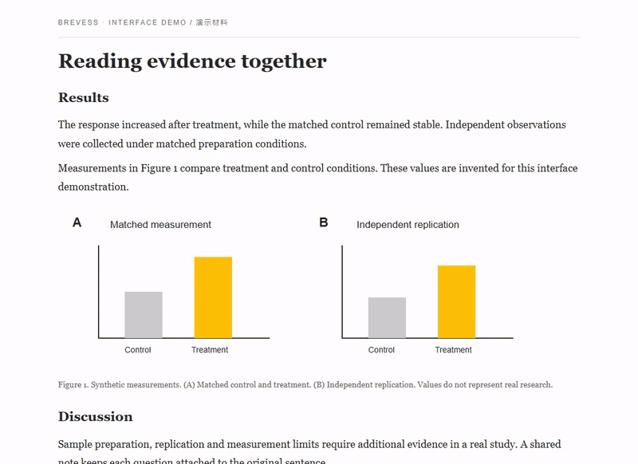
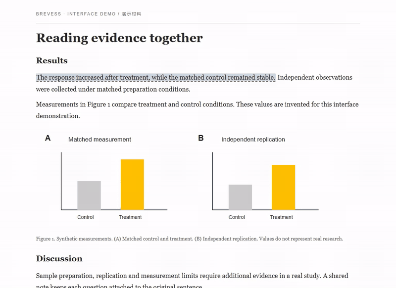
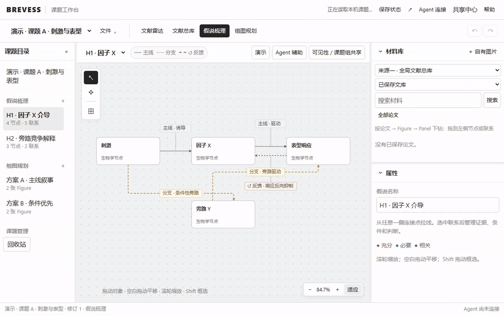

<h1 align="center">BREVESS</h1>

<strong>把论文读透，把想法连起来。</strong> 从原文高亮、Figure / Panel 解读，到假说梳理与组图规划。

Chrome / Edge · 免费开源 · 中文 / English

<a href="https://coolcoldplay.github.io/Brevess/"><strong>官网 · 看操作演示</strong></a> · <a href="https://github.com/coolcoldplay/Brevess/releases/download/v1.0.1-r37-r4-public/Brevess-v1.0.1-R37-r4-public-test.zip"><strong>下载插件测试包</strong></a> · <a href="使用教程.md">使用教程</a>

## 看一眼，就知道怎么用

| 划句与笔记 | 原文里的讨论 |
| :--- | :--- |
|  |  |
| 划选原文、写下判断，让笔记留在证据旁。 | 主动开启共享备注；点虚线句子讨论，可只看课题组成员。 |

**课题工作台：从文献积累，到假说与组图。**

| 你想做的事 | BREVESS 帮你完成 |
| :--- | :--- |
| 快速读一篇论文 | 大纲定位、手动高亮、笔记；接入模型后翻译、全文问答并追溯原文。 |
| 弄清一张图 | 按 Figure / Panel 解读、追问，每个 Panel 都有独立评论入口。 |
| 整理研究思路 | 文献雷达 → 文献总库 → 假说梳理 → 组图规划，支持方案导入导出。 |
| 和课题组一起读 | 登录后查看共享备注，组内筛选、回复、点赞，按时间或点赞数排序。 |

实录来自当前公开测试版；文章、图表、账号和评论均为演示材料，未调用真实 AI。更多动态画面与 [Panel 评论演示](https://coolcoldplay.github.io/Brevess/#demo-heading) 见官网。

## 三步安装

1. [下载 ZIP](https://github.com/coolcoldplay/Brevess/releases/download/v1.0.1-r37-r4-public/Brevess-v1.0.1-R37-r4-public-test.zip) 并解压，保留里面的 **browser-extension** 文件夹。
2. 打开 <code>edge://extensions/</code> 或 <code>chrome://extensions/</code>，开启**开发人员模式**，点击**加载解压缩的扩展程序**，选择该文件夹。
3. 固定 BREVESS 图标，在论文全文页点击图标，开始导航、划句与记录。

无需 API 也能体验导航、手动标注与课题工作台。AI 功能使用你自己的模型和 API Key。

**一起测试共享：** 向负责人获取服务地址，在「设置中心 → 账号管理 → 高级设置 · 服务连接」填写，注册、验证邮箱后接受课题组邀请。公开备注也需登录查看。公开包不预置实际服务地址；当前完全退出浏览器后需重新连接并登录。

## 了解更多

[完整教程](使用教程.md) · [当前测试版 Release](https://github.com/coolcoldplay/Brevess/releases/tag/v1.0.1-r37-r4-public) · [更新记录](docs/changelog/2026-10-19-r37-r4.md) · [隐私政策](docs/privacy-policy.md) · [工作流与提示词](docs/Brevess-完整工作流与提示词参考.md)

部分 PDF 增强能力与本机 Codex 接入需要可选本机伴侣，公开包不附带其二进制。见 [开源构建说明](OPEN_SOURCE.md)。AI 效果取决于模型服务；网页和 PDF 提取受文档结构影响。

## 联系与赞赏

[brevess0729@163.com](mailto:brevess0729@163.com) · [反馈问题](https://github.com/coolcoldplay/Brevess/issues) · [参与贡献](CONTRIBUTING.md)

赞赏自愿，用于支持持续开发。以下与插件内显示的二维码一致。

| 微信赞赏 | 支付宝赞赏 |
| :---: | :---: |
|  |  |

---

[AGPL-3.0-or-later](LICENSE) · [第三方声明](THIRD_PARTY_NOTICES.md) · [开发与发布](OPEN_SOURCE.md) · [安全问题](SECURITY.md)
