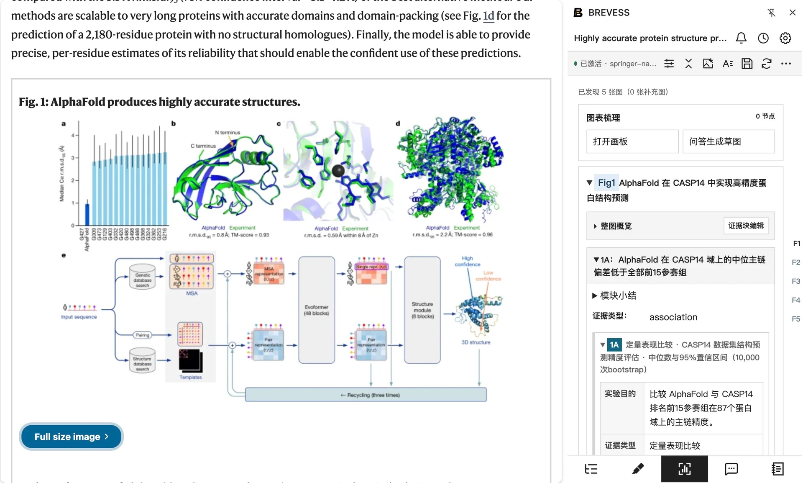
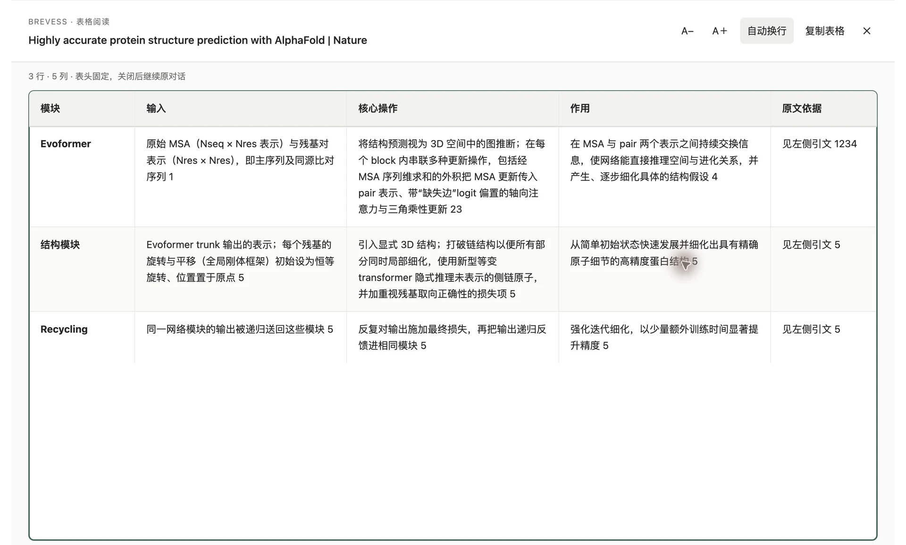
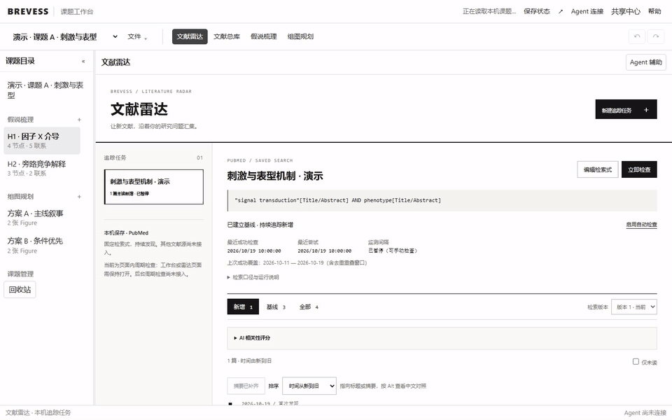
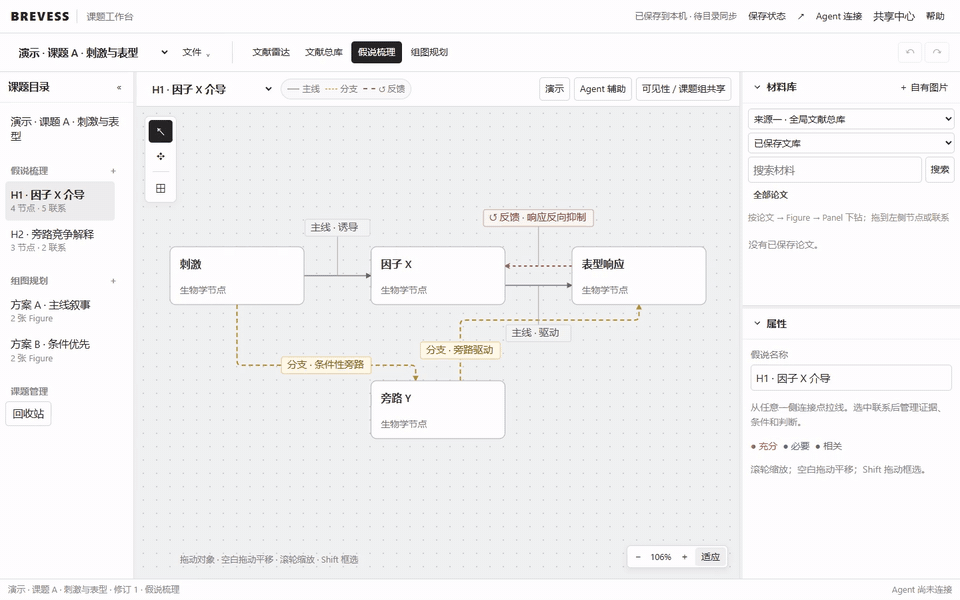

<p align="center"></p>
<h1 align="center">BREVESS</h1>
<p align="center"><strong>Brevity · Evidence · Essence</strong><br>从文献阅读，到科研思路。</p>
<p align="center">Chrome / Edge · 免费开源 · 中文 / English · 自备模型 API</p>
<p align="center"><a href="https://coolcoldplay.github.io/Brevess/"><strong>官网 · 实测演示</strong></a> · <a href="https://github.com/coolcoldplay/Brevess/releases/tag/v1.0.2-r27-20261117"><strong>1.0.2 r27 预览版</strong></a> · <a href="使用教程.md">使用教程</a></p>

**读论文 → 理解实验 → 整理证据 → 形成假说 → 规划实验与组图。**

## 最新版真实论文实测

继续使用 **AlphaFold 2 的 Nature 原论文**。以下画面采集于 **2026-11-17，Chrome，BREVESS 1.0.2 r27**，AI 输出来自实际 DeepSeek V4.1 Flash 调用。

### 原图与解读并排，逐项查看证据

选择 Figure 1 的图像输入，实际生成 A–E 五个 Panel 的解读。展开 1A，查看实验目的、设计、观察和解释。



[播放操作关键画面](https://coolcoldplay.github.io/Brevess/#features) · [直接查看 WebM](https://coolcoldplay.github.io/Brevess/assets/site/r27-figures.webm)

### 问答带原文引用，宽表格单独展开

提问：“用表格比较 Evoformer、结构模块和 recycling 的输入、核心操作、作用及原文依据。”点击回答中的引用回到论文，表格可在大窗口中完整浏览。



[查看原文引用定位画面](docs/assets/site/r27-chat-citation.webp) · [观看问答关键画面](https://coolcoldplay.github.io/Brevess/assets/site/r27-chat.webm)

**素材说明：**真实截图仅做裁剪、压缩和元数据清除，未改写 AI 回答。新视频按顺序展示操作关键画面，不是连续录屏，也不表示请求耗时。论文及 Figure 1：Jumper et al., [Nature (2021)](https://www.nature.com/articles/s41586-021-03819-2)，[CC BY 4.0](https://creativecommons.org/licenses/by/4.0/)。AI 解读需核对原文；[采集范围与限制](docs/media/alphafold-r27.md)。

## 五个阅读模块

- **导航**：从大纲进入段落概述，单击段落标记回到原文。
- **高亮**：手动划句，或按背景、问题、方法与结果标注正文。
- **解图**：逐 Figure / Panel 拆解实验，核对依据，继续追问。
- **问答**：围绕全文提问，通过引用定位原文，展开宽表格阅读。
- **笔记**：按研究背景、科学问题、主要发现等字段整理阅读所得。

段落标记与 Fig 标签：**单击定位，双击 AI 解读**。笔记字段圆点：单击选择、双击填写。问答输入问题后发送。阅读时不要求先选择文献类型。

当前版本包括重新整理的设置中心、模型服务商图标、紧凑的侧栏工具，以及跨网页显示滤镜。滤镜推广到相似网页前，需用至少两个网页样本比较并预览验证。

## 课题工作台

**文献雷达 → 文献总库 → 假说梳理 → 组图规划**

| 追踪与整理文献 | 形成机制假说 |
| :---: | :---: |
|  |  |
| 保存检索式、跟踪新增文献、查找来源。 | 用节点与连线梳理机制，记录支撑证据。 |

为每个 Panel 安排目的、实验设计与拟支持的结论。支持多套方案、本机保存、撤销重做与导入导出。

工作台动画为**早期版本实录**，使用合成文献和内置演示课题；未执行实时 PubMed 检索，不含个人研究资料，不作为本次版本的验收证据。

## 安装预览版

1. [下载浏览器 ZIP](https://github.com/coolcoldplay/Brevess/releases/download/v1.0.2-r27-20261117/Brevess-v1.0.2-r27-Chrome.zip)，解压到独立文件夹。
2. 打开 `chrome://extensions/`（Edge 使用 `edge://extensions/`）→ 开发者模式 → 加载已解压的扩展程序，选择包含 `manifest.json` 的文件夹。
3. 固定 BREVESS 图标，在论文全文页打开侧栏；在设置中心配置自己的模型。

大纲导航、离线规则、手动高亮、笔记编辑和工作台无需 API Key。部分增强功能需要可选本机伴侣，当前浏览器 ZIP 不包含本机二进制。

**这是预览版。**完整自动回归仍有失败和超时；补充图目录提取也可能不完整。请参阅[发布记录](https://github.com/coolcoldplay/Brevess/releases/tag/v1.0.2-r27-20261117)，不要把演示成功等同于全功能验收。尚未宣称通过 Chrome Web Store 审核。

## 源码与构建

Node.js 20+：

```sh
npm ci
npm run test:chrome-store
npm run build:public -- --name Brevess-Public-v1.0.2
```

公开预览包保留现有扩展标识，产物位于 `dist/<名称>/`。另需准备商店上传包时：

```sh
npm run build:chrome-store -- --name Brevess-Chrome-v1.0.2
npm run verify:chrome-store -- dist/Brevess-Chrome-v1.0.2
```

`npm test` 运行完整现有回归；已知范围见[发布检查说明](docs/chrome-store/RELEASE_READINESS.md)。构建与许可见 [OPEN_SOURCE.md](OPEN_SOURCE.md)。

## 联系与赞赏

[brevess0729@163.com](mailto:brevess0729@163.com) · [反馈问题](https://github.com/coolcoldplay/Brevess/issues)

| 微信赞赏 | 支付宝赞赏 |
| :---: | :---: |
|  |  |

[完整教程](使用教程.md) · [版本记录](https://github.com/coolcoldplay/Brevess/releases) · [隐私政策](docs/privacy-policy.md) · [AGPL-3.0-or-later](LICENSE)
