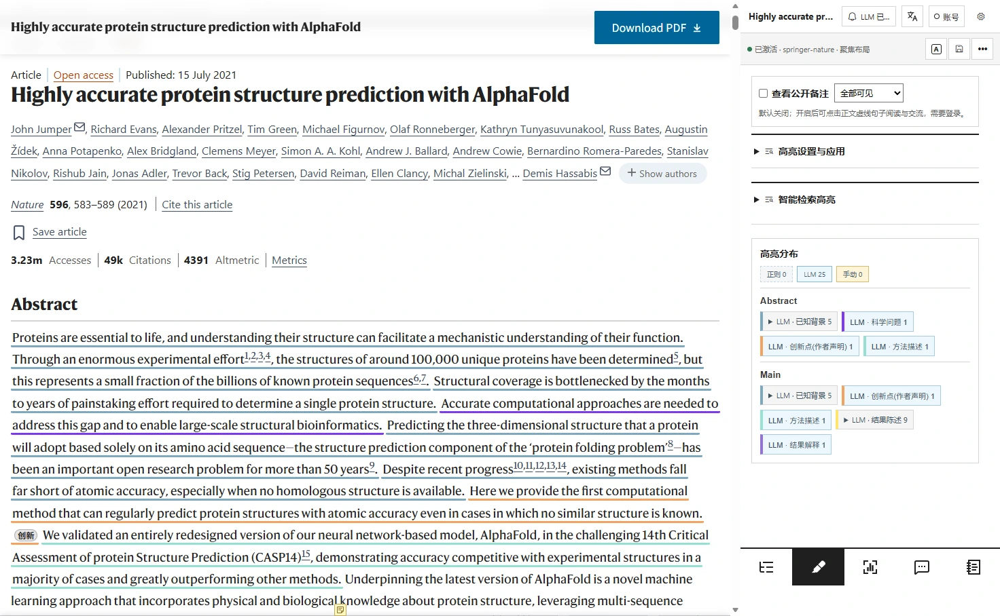
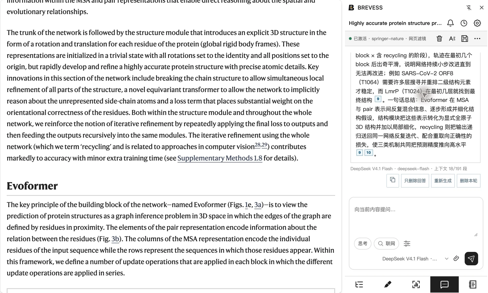
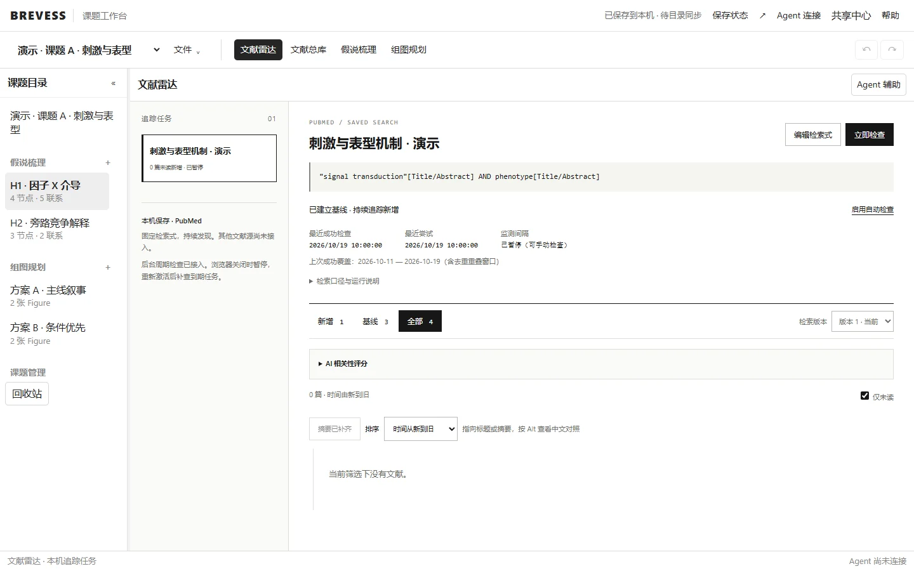
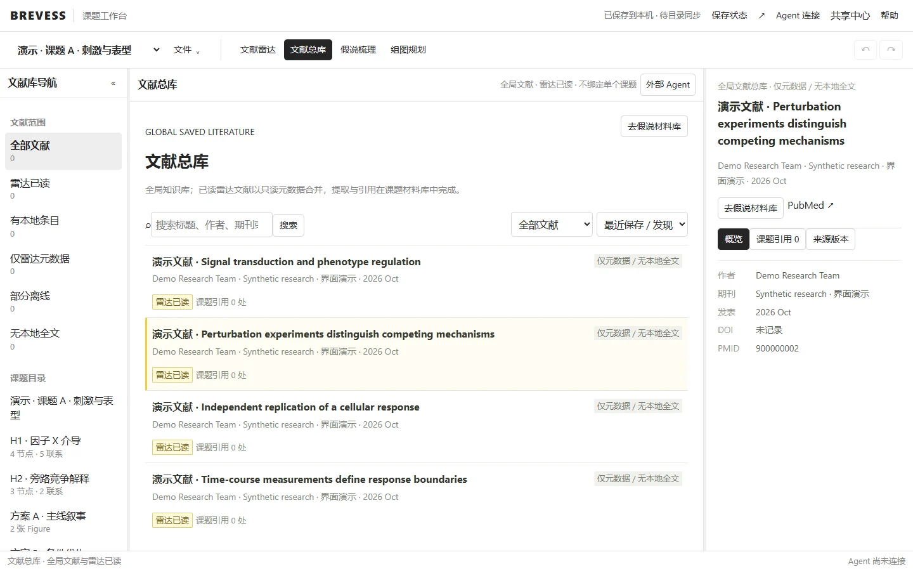
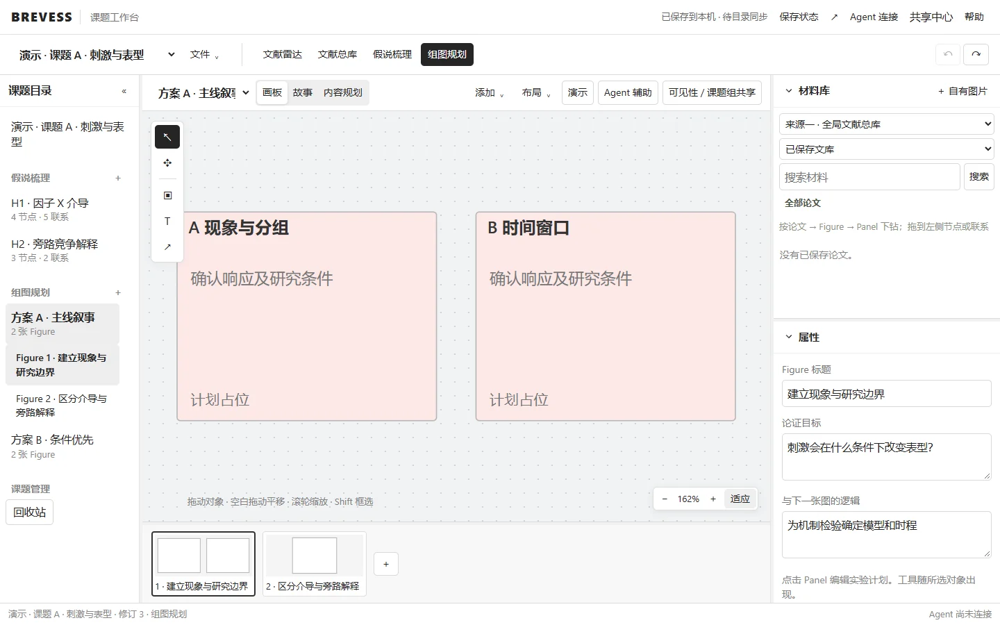

<p align="center"></p>
<h1 align="center">BREVESS · 布理维思</h1>
<p align="center"><strong>Brevity · Evidence · Essence</strong></p>
<p align="center">面向科研论文阅读与课题整理的 Chrome / Edge 浏览器扩展。</p>
<p align="center">Chrome / Edge · 免费开源 · 中文 / English · 自备模型 API / 本机 Agent</p>
<p align="center"><a href="https://coolcoldplay.github.io/Brevess/"><strong>官网 · 交互体验</strong></a> · <a href="https://github.com/coolcoldplay/Brevess/releases/tag/v1.0.2-r27-reader-r23.2"><strong>1.0.2 · r23.2</strong></a> · <a href="docs/使用教程.md">使用教程</a> · <a href="docs/AGENT_QUICK_CONNECT.md">Agent 接入</a></p>

读论文时，划线、看图、问答和记笔记往往分散在不同工具里，关掉网页后很难再串回自己的课题。BREVESS 把**单篇精读**和**课题整理**放在同一套浏览器流程里：先在侧栏把单篇论文拆透，保存后的标注、图解和笔记会直接进入本地工作台，供后续梳理假说、规划组图时复用，每一条都能跳回原文核对。

**大部分功能可纯手动完成，AI 按需开启。** 大纲导航、缩写表、离线正则、手动标注、笔记编辑和课题工作台都不需要 API Key；需要 AI 辅助时，可以填自己的模型 API，也可以连接电脑上已有的本机 Agent。

> 想先看实际手感，可直接打开 **[官网交互体验](https://coolcoldplay.github.io/Brevess/#features)**：基于真实侧栏与工作台界面，可试划句、翻译备注、展开 Figure / Panel、问答、编辑笔记并把材料拖入课题。无需登录或填 Key，AI 结果为预置示例。

---

## 一、单篇精读：侧栏五个模块

**大纲 → 高亮 → 解图 → 问答 → 笔记**

打开论文网页后点击扩展图标，右侧会呼出侧栏。五个模块按读一篇论文的自然顺序排列，所有摘要、高亮和问答引用都保留到原文的跳转锚点。

以下截图均取自 **AlphaFold 2 的 Nature 原论文**，其中解图与问答为模型实际生成的阅读示例，大纲、高亮和笔记展示同一篇论文的阅读过程。

### 1. 大纲：先看清结构，再决定精读哪段

自动提取论文的分层标题树和全文缩写表（纯本地解析，不消耗 Token），点击标题或缩写直接跳转原文。需要快速过内容时，可按整篇或单段调用 AI 生成概述，点一下概述即可回到对应段落。


[亲手体验大纲](https://coolcoldplay.github.io/Brevess/#features)

### 2. 高亮：自动筛主线，手动记重点

自动高亮支持**离线正则**和 **LLM 精确模式**，内置快速主线、机制证据链、批判性审读、综述脉络等分析视角；分析完成后可直接在本地调整置信度筛选，不会重复请求接口。手动划句可自定义类别并写备注。自动识别用粗下划线，手动标注用荧光笔背景，重叠时也能区分清楚。



[亲手体验高亮](https://coolcoldplay.github.io/Brevess/#features)

### 3. 解图：原图与解读并排，逐 Panel 拆实验

先在本地从网页结构和图注中生成 Figure / Panel 目录，支持高清原图缩放查看。接入视觉模型后，可以逐个 Panel 拆看实验目的、设计、观察与结论，也支持整图深度审读或把多张主图串成论证链。对解读有疑问可以继续追问，或者直接手动修订；若模型不支持视觉或图片受权限限制，会明确回退到图注和正文，不把纯文本分析伪装成看图。


[亲手体验解图](https://coolcoldplay.github.io/Brevess/#features)

### 4. 问答：基于全文追问，按引用回原文核对

在侧栏结合论文内容向大模型追问方法细节与结论边界：输入 `@` 可限定章节，输入 `/` 可调用自定义快捷提示词，回答里的引用点一下就能跳回正文核实。也支持用自然语言直接让模型在正文中“查找并高亮”。每轮对话都可以随时切换不同的模型或本机 Agent。



[亲手体验问答](https://coolcoldplay.github.io/Brevess/#features) · [查看宽表格展开示例](docs/assets/site/r27-chat-table.webp)

### 5. 笔记：把阅读所得整理成结构化记录

围绕研究背景、科学问题、关键证据和主要发现沉淀单篇笔记。编辑区支持表格、插图、原文划句编号，输入 `@F1A` 或 `@FS1A` 可直接引用已识别的主图或补图 Panel。可以完全自己写，也可以让 AI 先按正文起草，再手动调整。


[亲手体验笔记](https://coolcoldplay.github.io/Brevess/#features)

<sub>论文及图表：Jumper et al., [Nature (2021)](https://www.nature.com/articles/s41586-021-03819-2)，[CC BY 4.0](https://creativecommons.org/licenses/by/4.0/)。截图保留模型原始输出未改写；官网交互体验中的 AI 结果为预置示例。详见[素材记录与限制](docs/media/alphafold-r27.md)。</sub>

---

## 二、课题工作台：把单篇阅读接回自己的研究

**文献雷达 → 文献总库 → 假说梳理 → 组图规划**

单篇论文保存后，你的高亮、图解和笔记会沉淀到课题工作台，不再散落在浏览器标签页里。四个模块对应研究推进的不同环节：

| [1. 文献雷达](https://coolcoldplay.github.io/Brevess/#workbench) | [2. 文献总库](https://coolcoldplay.github.io/Brevess/#workbench) |
| :---: | :---: |
|  |  |
| 保存检索式，追踪新文献与阅读状态，管好“看什么”。 | 汇集已读文献、来源信息与阅读记录，方便按课题检索复用。 |

| [3. 假说梳理](https://coolcoldplay.github.io/Brevess/#workbench) | [4. 组图规划](https://coolcoldplay.github.io/Brevess/#workbench) |
| :---: | :---: |
|  |  |
| 在画布上用节点与连线组织机制逻辑，直接挂接原文证据。 | 按 Figure / Panel 排布实验设计与论证顺序，提前搭好论文骨架。 |

工作台同样可以从手动整理开始，按需让 AI 辅助补充思路；支持多套方案、本机保存、撤销重做与导入导出。

<sub>以上工作台截图为**早期版本实录**。点击上方模块标题可进入使用 r18 界面组件的[官网工作台](https://coolcoldplay.github.io/Brevess/#workbench)，体验材料引用、画布编辑和撤销。</sub>

---

## 三、不止 HTML 论文：普通网页、PDF 与本地数据

- **通用网页与 AI 对话**：划句翻译、双语对照阅读、选区朗读、高亮备注、大纲跳转、语义检索和侧栏问答不只限于论文页，也适合读技术文档、GitHub 仓库和长篇 AI 对话。可以在[官网“不止论文”场景](https://coolcoldplay.github.io/Brevess/#beyond-papers)里试一下 GitHub 仓库与经授权 ChatGPT 对话的整屏交互示例（AI 辅助为预置示例）。
- **浏览器内读 PDF**：直接打开论文 PDF 也能激活 PDF 工作台并建立本地文字索引；配置可选的 MinerU Token 后，可提取章节、正文与图表并继续使用导航、解图和问答。（PDF 工作台暂不把高亮映射回原 PDF 坐标；需要精确原文高亮时建议优先打开 HTML 全文页。）
- **数据存本机，方便迁移和导出**：设置、标注、文献记录和工作台默认保存在本机，也可同步到指定的本地文件夹；支持单篇 JSON 导入导出、整机迁移备份、导出到 Zotero，以及导出包含原图和结构化内容的 PPT 材料包（供 PowerPoint 或视觉模型继续制作汇报，非直接生成 `.pptx`）。

---

## 四、模型与本机 Agent 接入

BREVESS 免费开源，不包含模型额度，也不绑定特定服务商，你可以按习惯选择使用方式：

- **暂不配置**：直接使用大纲、缩写表、离线正则、手动高亮、笔记编辑和课题工作台。
- **自备模型 API**：支持 DeepSeek、OpenAI、Anthropic Claude、Google Gemini，以及 Kimi、智谱 GLM、通义千问、豆包、混元、千帆、MiniMax 和自定义 OpenAI 兼容接口。可为高亮、段落概述、逐图解读、跨图串解分别路由不同模型，并在设置页查看 Token 统计。开启 AI 发送后，任务所需的正文、图注或图片会直接发往你选择的服务商。
- **连接本机 Agent**：支持对接电脑上已有的 WorkBuddy、DeepSeek Harness、Codex、Google Antigravity、Claude Code、Cursor、Qwen Code、Kimi Code 等客户端。既可作为侧栏问答通道，也可通过 MCP 供 Agent 查询文献总库与课题材料（涉及课题写入需在插件内单独授权）。详细步骤见 [Agent 接入指南](docs/AGENT_QUICK_CONNECT.md)。

---

## 五、安装预览版

1. [下载浏览器 ZIP](https://github.com/coolcoldplay/Brevess/releases/download/v1.0.2-r27-reader-r23.2/Brevess-v1.0.2-r23.2-Chrome-Edge.zip)，解压到一个长期保留的独立文件夹。
2. 打开 `chrome://extensions/`（Edge 打开 `edge://extensions/`）→ 开启「开发者模式」→ 点击「加载已解压的扩展程序」，选择直接包含 `manifest.json` 的文件夹。
3. 点击工具栏中的 BREVESS 图标 →「开始配置」：
   - **用模型 API**：粘贴 DeepSeek API Key，确认发送给服务商的数据范围，点击「测试连接并完成」（其余模型可在设置页继续添加）。
   - **连本机应用**：点击「连接本机应用」，按界面指引对接已安装的客户端。
   - **先手动阅读**：点击「暂不配置，先手动阅读」，保存文件夹和模型配置都可以稍后再设。

> **关于 r23.2 公开预览版**：简化了首次配置流程，连接暂时中断时可保留输入并重试；本机应用设置内置 WorkBuddy、DeepSeek Harness、Codex 和 Google Antigravity 的连接指引，并区分模型列表与实际问答的验证结果。当前浏览器 ZIP 不包含可选的本机伴侣二进制。详见[版本说明](https://github.com/coolcoldplay/Brevess/releases/tag/v1.0.2-r27-reader-r23.2)与[完整使用教程](docs/使用教程.md)。

---

## 六、源码与构建

仓库结构：插件源码在 [`extension/`](extension/)，构建脚本在 `scripts/`，回归测试在 `tests/`，官网与文档在 `docs/`。

如果从 GitHub 克隆或下载源码加载，请在浏览器「加载已解压的扩展程序」中选择 **`extension/` 文件夹**（Release ZIP 仍选择解压后直接包含 `manifest.json` 的文件夹）。

构建环境需要 Node.js 20+，以下命令均在仓库根目录运行：

```sh
npm ci
npm run test:chrome-store
npm run build:public -- --name Brevess-Public-v1.0.2
```

公开预览包保留现有扩展标识，产物输出至 `dist/<名称>/`。需要构建商店上传包时：

```sh
npm run build:chrome-store -- --name Brevess-Chrome-v1.0.2
npm run verify:chrome-store -- dist/Brevess-Chrome-v1.0.2
```

运行完整现有回归可使用 `npm test`，已知范围见[发布检查说明](docs/chrome-store/RELEASE_READINESS.md)，构建与许可说明见 [OPEN_SOURCE.md](extension/OPEN_SOURCE.md)。

---

## 联系与赞赏

[brevess0729@163.com](mailto:brevess0729@163.com) · [反馈问题](https://github.com/coolcoldplay/Brevess/issues)

| 微信赞赏 | 支付宝赞赏 |
| :---: | :---: |
|  |  |

[完整教程](docs/使用教程.md) · [版本记录](https://github.com/coolcoldplay/Brevess/releases) · [隐私政策](docs/privacy-policy.md) · [AGPL-3.0-or-later](LICENSE)
