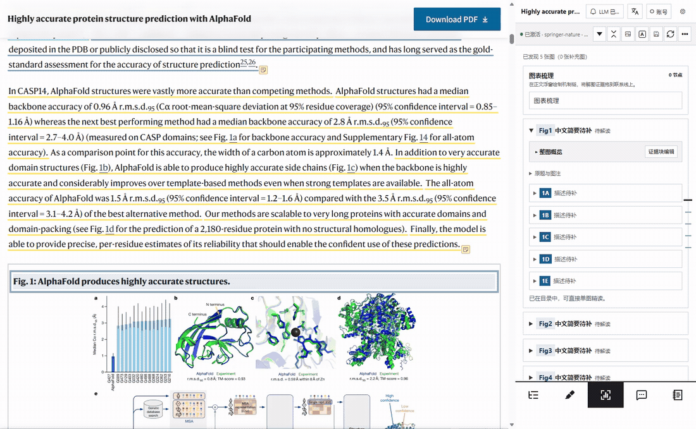
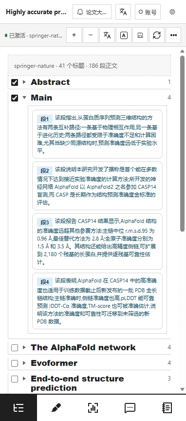
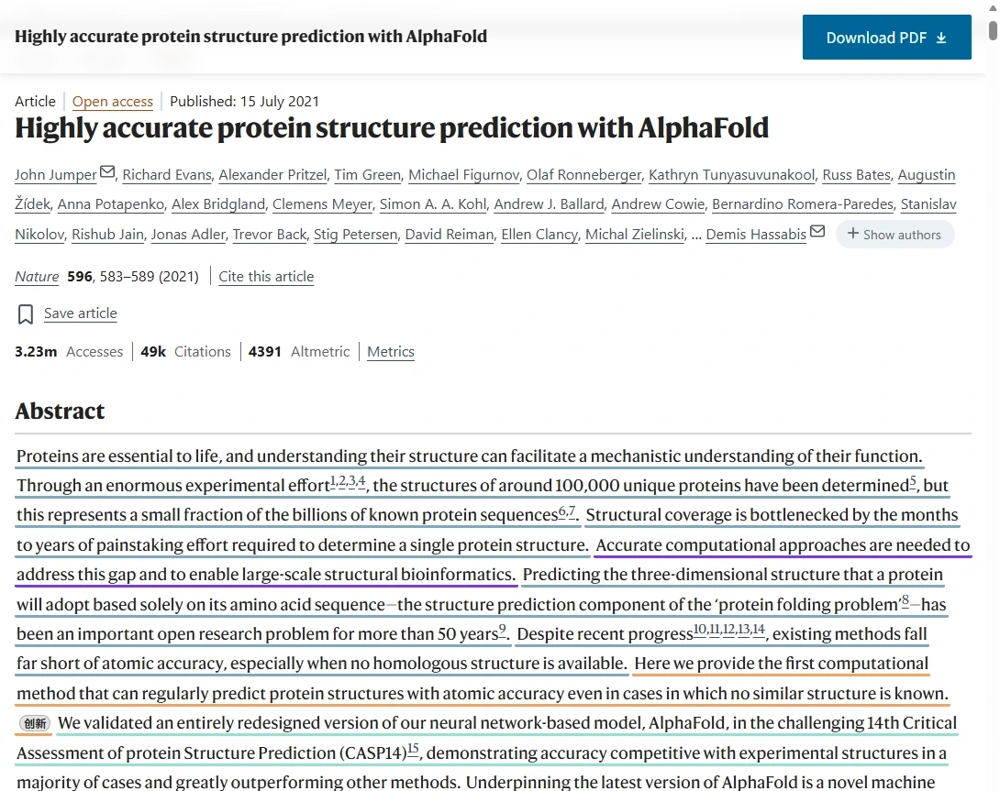
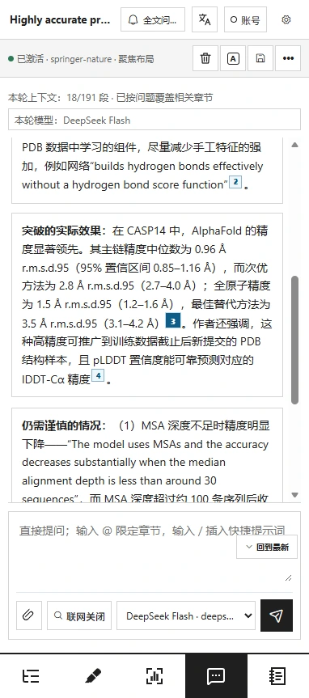
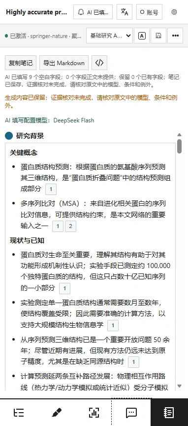
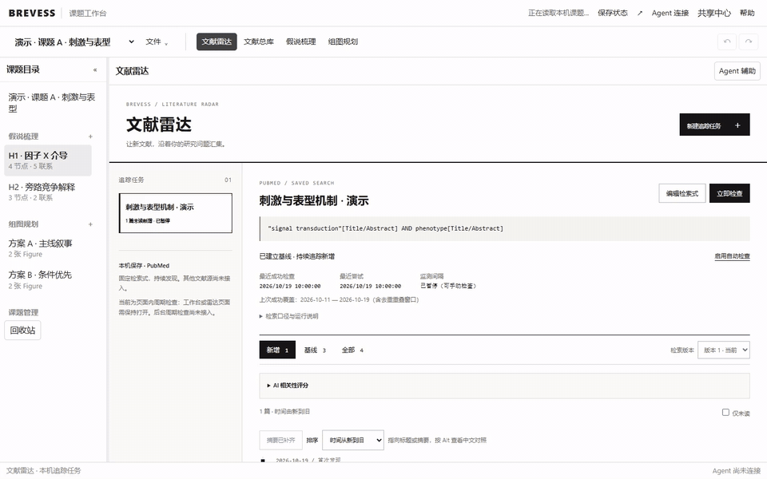
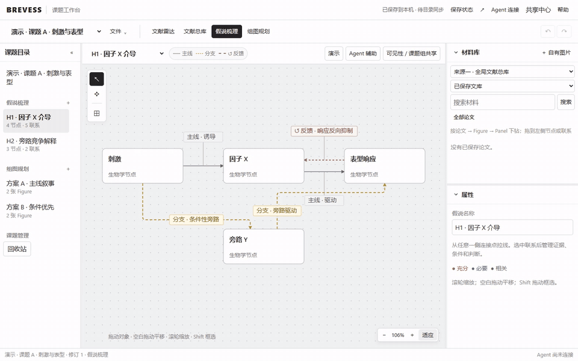
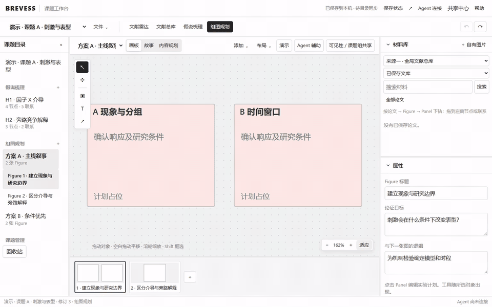

<h1 align="center">BREVESS</h1>

<strong>Brevity · Evidence · Essence</strong> 通过 AI 增强从科研文献阅读到形成科研思路的完整流程。

Chrome / Edge · 免费开源 · 中文 / English

<a href="https://coolcoldplay.github.io/Brevess/"><strong>官网 · 操作演示</strong></a> · <a href="https://github.com/coolcoldplay/Brevess/releases/download/v1.0.1-r37-r4-public/Brevess-v1.0.1-R37-r4-public-test.zip"><strong>下载测试版</strong></a> · <a href="使用教程.md">使用教程</a>

**读论文 → 理解实验 → 整理证据 → 形成假说 → 规划实验与组图。**

## 论文在左，AI 阅读侧栏在右

用 **AlphaFold 2 的 Nature 原论文**实测：双击 Fig1、选择原图输入，生成 A–E 五个 Panel 的实验设计、观察与解读。

## 五个阅读模块

- **导航**：从大纲进入段落概述，单击段落标记回到原文。
- **高亮**：按背景、问题、方法与结果等语义标注正文。
- **解图**：逐 Figure / Panel 拆解实验，核对依据，继续追问。
- **问答**：围绕全文提问，通过回答中的引用定位原文。
- **笔记**：按研究背景、科学问题、主要发现等字段整理阅读所得。

| 导航：段落概述 | 高亮：正文语义标注 |
| :---: | :---: |
|  |  |

| 问答：回答与原文引用 | 笔记：结构化阅读记录 |
| :---: | :---: |
|  |  |

段落标记与 Fig 标签：**单击定位，双击 AI 解读**。笔记字段圆点：单击选择、双击填写。问答输入问题后发送。

论文来源与实录说明

Jumper, J., Evans, R., Pritzel, A. et al. [Highly accurate protein structure prediction with AlphaFold](https://www.nature.com/articles/s41586-021-03819-2). *Nature* **596**, 583–589 (2021). DOI: 10.1038/s41586-021-03819-2。原文及所示 Figure 1 使用 [CC BY 4.0](https://creativecommons.org/licenses/by/4.0/) 许可。

在 Nature 原文页与 Edge 原生侧栏中实际操作，正文和侧栏由浏览器分别采集、同步合成；等待已缩短，局部图为实际画面裁剪。中文结果来自 DeepSeek Flash 实际调用，AI 标注与解读不属于原论文。导航和高亮演示 Abstract、Main；解图演示 Figure 1。

问答使用修正了本机连接流式兼容问题的开发候选，当前公开包尚不包含该修正。笔记已生成并保存九个字段，证据核对仍未完成，画面保留提示。实录用于展示操作，不代表 AI 科学解读经过全面验证。

## 课题工作台：把阅读所得用于自己的研究

**文献雷达 → 文献总库 → 假说梳理 → 组图规划**

| 追踪与整理文献 | 形成机制假说 |
| :---: | :---: |
|  |  |
| 保存检索式，跟踪新增文献。总库统一查找论文、来源和课题引用。 | 用节点与连线梳理机制，比较不同假说，记录支撑证据。 |

为每个 Panel 安排**目的、实验设计与拟支持的结论**。支持多套方案、本机保存、撤销重做，以及课题／假说／方案的导入导出。

工作台画面使用合成文献与演示课题，展示实际界面操作；不属于上述 AlphaFold 实验，也未执行实时 PubMed 检索。

## 安装

1. [下载 ZIP](https://github.com/coolcoldplay/Brevess/releases/download/v1.0.1-r37-r4-public/Brevess-v1.0.1-R37-r4-public-test.zip) 并解压。
2. 打开 `edge://extensions/` 或 `chrome://extensions/` → 开发人员模式 → 加载解压缩的扩展，选择 **browser-extension** 文件夹。
3. 固定 BREVESS 图标，在论文全文页打开侧栏；在设置中心配置 AI 模型。

大纲导航、离线规则、手动高亮、笔记编辑和工作台无需 API Key。AI 功能需配置模型；部分能力需要可选本机伴侣，见 [构建说明](OPEN_SOURCE.md)。公开备注与课题组评论仍在开发中。

## 联系与赞赏

[brevess0729@163.com](mailto:brevess0729@163.com) · [反馈问题](https://github.com/coolcoldplay/Brevess/issues)

| 微信赞赏 | 支付宝赞赏 |
| :---: | :---: |
|  |  |

[完整教程](使用教程.md) · [版本记录](https://github.com/coolcoldplay/Brevess/releases) · [隐私政策](docs/privacy-policy.md) · [AGPL-3.0-or-later](LICENSE)
